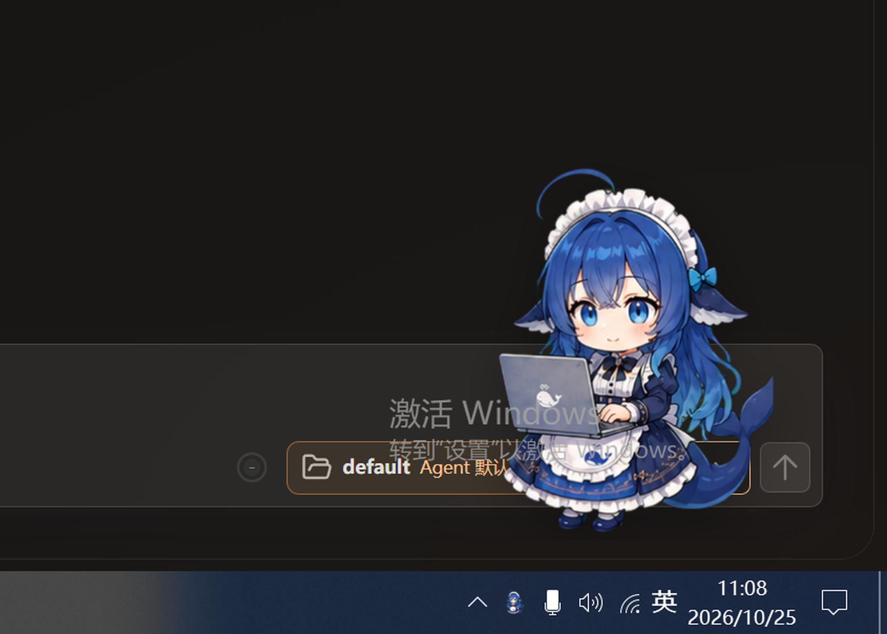
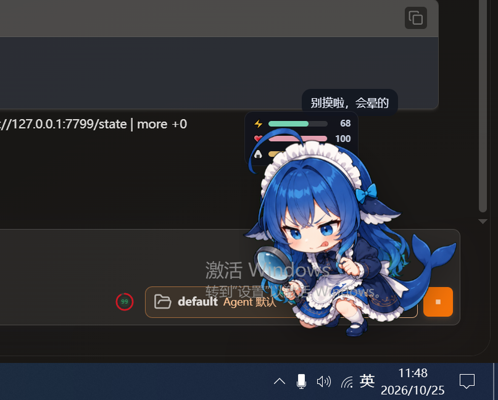
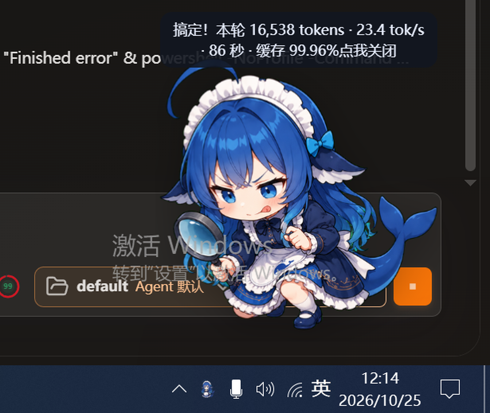

# QwenPaw Whale Pet · 鲸鱼娘桌宠（QwenPaw 版）

把 [dsh-whale-musume](https://github.com/Sutera-Diffusus/dsh-whale-musume)（DeepSeek Harness 的鲸鱼娘桌宠，MIT）
移植到 **QwenPaw** 的独立桌面外挂。



**English:** A QwenPaw port of the dsh-whale-musume desktop pet — independent Tauri overlay,
local state bridge (`/api/chats` → `/state`), tool-aware poses, stamina/mood/satiety stats,
per-turn token & tok/s report, click-through mode, and 47 wired reaction states.

> 这不是简单换皮：原版的宿主是 DSH 插件（注入页面 DOM），本项目改成**独立进程 + 本地状态桥**，
> 并在此基础上追加了**工具姿势、三项数值、token 结算、穿透模式、47 个状态触发规则**等改造。



---

## 和原版相比，这个 fork 做了什么

| 能力 | 原版（DSH 插件） | 本项目 |
|---|---|---|
| 宿主形态 | 注入 DSH 网页/桌面的 cordis 插件 | **独立 Tauri 外挂**，透明置顶、不进任务栏，不受宿主升级影响 |
| 状态来源 | 读 DSH 页面 DOM 标记 | **`bridge.py` 轮询 QwenPaw `GET /api/chats`**，提取 `status` / 工具名 / token 用量 |
| 工具姿势 | 按 DSH 工具卡切换 | **映射 QwenPaw 工具名** → 审阅 / 记笔记 / 调试 / 部署 / 会议 / 内存 / 截止 / 老板 / 协作 |
| 数值系统 | 有 | **电量 / 心情 / 饱食度**：60 秒衰减、工作耗电、投喂与摸头加成、`stats.json` 持久化 |
| token 结算 | 无 | **每轮结束显示** `本轮 N tokens · X tok/s · Y 秒 · 缓存命中 Z%`（取自 `qwenpaw_turn_usage`） |
| **声音提醒** | 无 | 任务**成功**响一声可爱确认音；**异常结束 / 等待你处理**响提示音。多屏或不在屏幕前时不必盯屏幕 |
| 通知气泡 | 短暂提示 | **常驻**，点击关闭，下一轮任务开始才替换 |
| 交互 | 摸头 / 投喂 / 小游戏 / 成就 | 摸头、投喂、**双击调戏**、**悬停好奇**、**空闲小动作**（尾巴/ wink / 墨镜 / meme）、**连续摸头害羞**、**连续完成出星**、**报错反应**、**夜间姿态**、**节日彩蛋**（圣诞/万圣/情人节/中秋/春节） |
| 窗口 | 跟随宿主 | 透明置顶、可拖动、**四档尺寸**、**穿透模式**（托盘切换，鼠标可穿过）、托盘显示隐藏 |
| 状态覆盖 | 多状态 | **82 个素材中已接 47 个触发规则**，0 缺失引用 |

---

## 架构

```
QwenPaw (GET /api/chats, /api/chats/{id})
        │  轮询：status / 最后工具 / qwenpaw_turn_usage
        ▼
   bridge.py  ──►  http://127.0.0.1:7799/state
        │           { status, tool, pose, tokens, last_turn{tps,...}, stats }
        ▼
Tauri 外挂（透明窗口 + 原版 WebP 素材 + CSS 动效）
```

**唯一契约是 `/state`。** 后续接 PawApp 插件时，只要插件后端提供同一个 `/state`，外挂不用改一行代码。

---



---

## 快速开始（Windows）

```bat
:: 1) 装依赖（只需一次）
pip install -i https://mirrors.aliyun.com/pypi/simple PyQt6

:: 2) 启动（会自动拉起状态桥）
wscript 启动鲸鱼娘.vbs
```

或手动：

```bat
D:\Miniconda\pythonw.exe overlay\bridge.py
overlay\src-tauri\target\release\whale-pet.exe
```

构建外挂：

```bat
cd overlay\src-tauri
cargo build --release
```

> 需要 Rust（stable）、WebView2、MSVC Build Tools。首次构建约 1 分钟（依赖已缓存）。

---

## 交互

| 操作 | 效果 |
|---|---|
| 左键拖 | 移动位置（记忆） |
| 单击 / 12 秒内 3 次 | 摸头 / 害羞 |
| 双击 | 调戏 |
| 悬停 | 好奇 |
| 右键 | 投喂 / 摸头 / 睡觉 / 显示数值 / 四档大小 / 隐藏 / 退出 |
| 托盘右键 | 显示隐藏 / **👻 穿透模式** / 退出 |
| F9 | 弹一条样例 token 通知（调试用） |
| F10 / F11 | 试听成功音 / 提醒音 |
| 右键 → 🔔 声音开/关 | 静音切换（记忆） |

---

## 目录

```
overlay/
├─ dist/           前端（index.html / app.js / style.css / assets）
├─ src-tauri/      Tauri 外挂（Rust）
├─ bridge.py       状态桥：工具名 / token / 三项数值
├─ launch.bat      幂等启动
├─ stop_pet.bat    停止
└─ stats.json      数值持久化（运行时生成）
shared/
└─ state.schema.json   /state 契约
docs/
└─ screenshots/
```

---

## 声音

- 素材：Kenney **Interface Sounds**（CC0，可商用），`confirmation_002` / `error_004`
- 做了轻微升调处理，让音色更轻快
- 位置：`overlay/dist/audio/success.wav`、`alert.wav`
- 触发：
  - `running → idle` 且无错误 → **成功音**
  - 工具输出含 error/traceback，或会话进入 waiting / approval 类状态 → **提醒音**
- 浏览器自动播放策略可能在**你第一次点击桌宠之前**拦下声音；被拦时气泡会提示“声音被系统拦了”

## 许可与署名

- 本项目代码：**MIT**（见 `LICENSE`）
- 角色与素材：来自 [Sutera-Diffusus/dsh-whale-musume](https://github.com/Sutera-Diffusus/dsh-whale-musume)，**MIT**，版权归原作者
- 详见 `NOTICE`

如果你要二次分发，请保留上游版权声明；素材请勿单独拆出当作自有美术资源发布。

---

## English

### What this is

A **QwenPaw port** of [dsh-whale-musume](https://github.com/Sutera-Diffusus/dsh-whale-musume) (MIT).
The original is a DeepSeek Harness plugin that injects into the host page; this project turns it into a
**standalone Tauri desktop overlay** driven by a local state bridge, and adds a set of behaviours on top.

### What this fork adds

| Area | Original | This fork |
|---|---|---|
| Host | cordis plugin inside DSH UI | **standalone Tauri overlay**: transparent, always-on-top, hidden from taskbar |
| State source | DSH DOM markers | **`bridge.py` polls QwenPaw `GET /api/chats`**: status, last tool, token usage |
| Poses | DSH tool cards | **QwenPaw tool → pose mapping**: review / note / debug / deploy / meeting / ram / deadline / boss / slack |
| Stats | — | **battery / mood / satiety** with 60s decay, feeding & head-pat bonuses, persisted |
| Token report | — | per-turn `output tokens · tok/s · seconds · cache hit`, shown in a **sticky bubble** |
| Sound | — | cute **success** chime and **attention** alert (Kenney CC0), for multi-monitor work |
| Interaction | head-pat / feed / mini-game | hover, double-click tease, idle fidgets, repeated head-pat blush, streak star, error reaction, night & festival states |
| Window | follows host | four sizes, **click-through mode**, tray menu, drag & position memory |

82 state images are bundled; **47 of them are wired to triggers**, with zero missing references.

### Architecture

```
QwenPaw (GET /api/chats, /api/chats/{id})
        │  status / last tool / qwenpaw_turn_usage
        ▼
   bridge.py  ──►  http://127.0.0.1:7799/state
        │          { status, tool, pose, tokens, last_turn{tps,...}, stats }
        ▼
Tauri overlay (transparent window + upstream WebP assets + CSS motion)
```

`/state` is the only contract. A future PawApp plugin can serve the same endpoint and the overlay
needs no changes.

### Quick start (Windows)

```bat
pip install -i https://mirrors.aliyun.com/pypi/simple PyQt6
wscript 启动鲸鱼娘.vbs
```

Build the overlay yourself:

```bat
cd overlay\src-tauri
cargo build --release
```

Requires Rust (stable), WebView2 and MSVC Build Tools.

### Interaction

drag to move · click to head-pat (3x = blush) · double-click to tease · hover = curious ·
right-click menu (feed / sleep / HUD / sound / size / hide / quit) · tray menu (show-hide / click-through / quit)

### Known limits

- QwenPaw's `/api/chats` exposes only `idle` / `running`; there is no persisted "waiting for approval" state
  (`/api/notifications`, `/api/permissions`, `/api/approvals` all 404). The success/error sounds work;
  the permission alert needs the console SSE stream instead.
- WebView2 autoplay policy may block sound until you click the pet once.
- Tool pose follows the **last** tool call, with up to ~2s lag.

### License

MIT, with upstream attribution — see `LICENSE` and `NOTICE`. Artwork belongs to the upstream author;
please don't republish the assets as your own pack.
